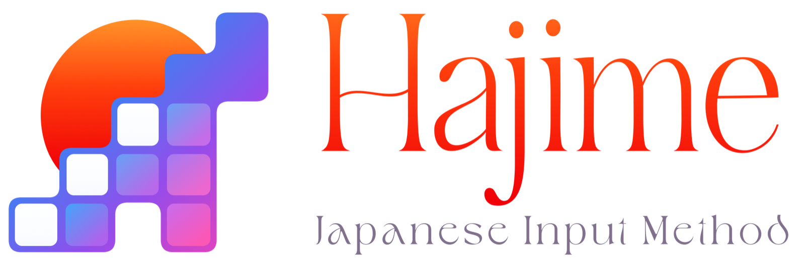

  

-lightgrey.svg)

A Japanese input method for macOS and Windows. Kana-kanji conversion uses the [azooKey](https://github.com/azooKey/AzooKeyKanaKanjiConverter) engine and the Zenzai neural language model.

Hajime IME is under active development, and its behavior may change.

## Features

- Live conversion
- Branch map of candidates
- Segment resizing, splitting, and retyping
- Automatic typo correction with suggestions
- English spelling correction
- English input mode
- Association
- Arithmetic, postal code, date and time, and symbol conversion
- Writing aids
- Handwriting input
- Dictionary import
- Customizable key bindings and themes
- Per-app input settings
- Settings sync and backup

## Installation

| OS | Requirements | Download |
|---|---|---|
| macOS | macOS 14 or later | [Latest release](https://github.com/KikuchiTomo/Hajime/releases/latest) |
| Windows | Windows 10 22H2 or later (64-bit) | [Latest release](https://github.com/KikuchiTomo/Hajime/releases/latest) |
| Linux (WIP) | | Not yet available |

We recommend restarting your PC after installation.

## Code signing policy

macOS releases are signed with an Apple Developer ID certificate and notarized by Apple. The Windows installer is currently unsigned. Once our application to the SignPath Foundation program for open source projects is approved, Windows releases will be signed as follows.

Free code signing provided by [SignPath.io](https://about.signpath.io), certificate by [SignPath Foundation](https://signpath.org)

- Committers and reviewers: [KikuchiTomo](https://github.com/KikuchiTomo)
- Approvers: [KikuchiTomo](https://github.com/KikuchiTomo)
- Privacy policy: This program will not transfer any information to other networked systems unless specifically requested by the user or the person installing or operating it. See the [privacy policy](https://haji.men/privacy/) (in Japanese).

The full policy is on the [code signing policy](https://haji.men/code-signing-policy/#code-signing-policy) page.

## License

MIT License ([LICENSE](LICENSE)).

Hajime IME uses azooKey (MIT) and the Zenzai model (Apache-2.0). Copyright notices are in [THIRD_PARTY_NOTICES.md](THIRD_PARTY_NOTICES.md) and on the About page of the app's settings.

To report a vulnerability, see [SECURITY.md](SECURITY.md).

日本語: [README.md](README.md)
