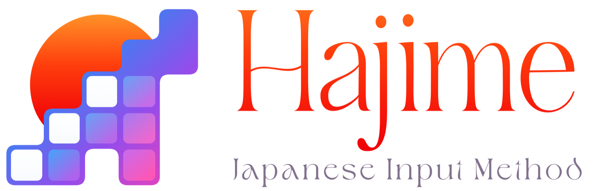

  

-lightgrey.svg)

macOS・Windows 向けの日本語入力システムです．
かな漢字変換には [azooKey](https://github.com/azooKey/AzooKeyKanaKanjiConverter) のエンジンと，ニューラル言語モデルの Zenzai を使用しています．

## 機能

- ライブ変換
- ツリー表示による変換候補の表示
- 文節の調整・分割・入力し直し
- AIによる打ち間違いの自動補正・もしかして予測変換 (macOSのみで有効)
- 英単語のつづりの自動補正
- 英字入力
- 日本語の表現連想変換機能
- 計算・郵便番号・日付と時刻・記号の変換
- 校正支援
- 手書き入力
- 辞書の取り込み
- キー操作とテーマのカスタマイズ
- アプリごとの入力設定
- 設定の同期とバックアップ

## インストール

| OS | 対応バージョン | ダウンロード |
|---|---|---|
| macOS | macOS 14 以降 | [最新のリリース](https://github.com/KikuchiTomo/Hajime/releases/latest) |
| Windows | Windows 10 22H2 以降(64 ビット) | [最新のリリース](https://github.com/KikuchiTomo/Hajime/releases/latest) |
| Linux (WIP) | | 準備中 |

インストール後には，お使いの PC の再起動を推奨します．

## ライセンス

MIT License です([LICENSE](LICENSE))．

使用しているオープンソースソフトウェアの著作権表示は[こちら](THIRD_PARTY_NOTICES.md)を確認ください．

脆弱性の報告は [SECURITY.md](SECURITY.md) をご覧ください．

English: [README.en.md](README.en.md)
